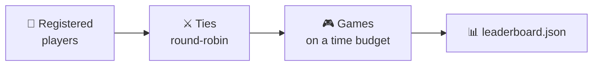

# The tournament

The tournament runs **every registered player** against every other and writes a
results file that the [web app](web.md) renders as a scoreboard.



You run it yourself with `conecta-cuatro-torneo`, and a scheduled GitHub Action runs it
too.

---

## A “tie” is many games

Two players do not play one game: they play a **series**. For each starting
board, and with each of them moving first once, `--repetitions` games are
played.

```text
games in a tie = number of boards × 2 × repetitions
```

With the defaults (3 boards, 3 repetitions) that is **18 games** per pair.

!!! info "Why who starts is alternated"
    In Connect Four the first player has a real advantage (with perfect play,
    they win). Without alternating, the tournament would measure the coin toss
    instead of the skill.

The default **starting boards** are three **openings** on the 6×7 board:
empty, `3, 3` (the first two pieces stacked in the centre) and `0, 6` (in the
corners). Without different openings, two deterministic bots would replay the
very same game every time.

!!! note "Draws exist"
    If the board fills up with no four in a row, the game is a **draw**: one
    point to each player in the standings (a win is worth three) and half a
    result (0.5) to each in the Elo rating. That game's `winner` is the empty
    string.

---

## The three formats

| Format | Pairings | Ranking |
|--------|----------|---------|
| `simple` *(default)* | round-robin, each pair once | points (3 per win, 1 per draw) |
| `league` | round-robin, each pair once | Elo rating |
| `championship` | group stage + knockout bracket | points and a champion |

Pick one with `--tournament`.

??? info "Detail of `league` and `championship`"
    **`league`** uses the same round-robin as `simple`, but ranks by an
    [Elo rating][conecta_cuatro.elo] updated game by game (K=32, start 1500).
    `--no-elo` falls back to points.

    **`championship`** splits the players into balanced **groups of four**; each
    group plays a round-robin and its **top two advance** to a seeded knockout
    bracket (with byes for the top seeds when the count is not a power of two).
    Each knockout round is a full tie; if it ends level, the higher seed goes
    through.

??? info "Why a player can show up as `hard_0` and `hard_1`"
    A player type can be entered **more than once**, each copy with its own
    seed, which is what lets a type compete against *itself* — a round-robin
    never pairs an instance with itself. Copies are named `<type>_<seed>`, and
    the scoreboard renders that suffix as a subscript.

    Reference players are entered **twice** and PR submissions **once**, because
    the submission side grows with every merged PR and the work grows with the
    square of the roster. `--player-repetition` overrides it.

---

## Robustness: one bad bot never breaks the run

Even well-meaning bots can hang, crash or return an illegal move in some corner
case. The tournament survives all of it:

| Failure | Result |
|---------|--------|
| goes over its game budget, or hangs | loss (`forfeit_timeout`) |
| raises an exception while playing | loss (`forfeit_error`) |
| returns an illegal or malformed move | loss (`forfeit_illegal`) |
| `create()` goes over the budget | loss (`forfeit_build_timeout`) |
| `create()` raises an exception | loss (`forfeit_build_error`) |

In every case the reason is recorded and the run **continues**.

---

## The time budgets

Each player gets **two budgets per game**, not per move:

| Budget | Default | Covers |
|---|---|---|
| game (`--game-time-limit`) | 2 s | all your thinking time in that game, cumulative |
| build (`--build-time-limit`) | 2 s | `create()` |

They are cumulative: a bot can burn nearly all of its budget on a hard position
and play the rest instantly. They are kept apart so free precomputation cannot
be smuggled into the constructor.

!!! warning "Timing is measured in CI"
    The official tournament runs on **GitHub runners**, slower and more variable
    than a laptop. A bot that passes on your machine can still time out there.
    It is a stated rule, not a surprise.

??? info "How the limit is actually enforced"
    Each **game** runs in its own process. If a bot hangs in an infinite loop,
    the process is **killed** and the bot loses; the tournament goes on. Python
    threads cannot be force-killed, so a thread-based timeout could not
    guarantee this.

    Forking per game and not per move is deliberate: a player's caches and
    random-generator position have to survive from one move to the next *within
    their own game*.

    `--no-subprocess` gives a single-process “soft timeout” mode for quick local
    runs; it still forfeits anyone who overruns, but it cannot interrupt a real
    infinite loop.

---

## Running it

```bash
# The usual: simple tournament, writes the ranking
conecta-cuatro-torneo --out results/leaderboard.json

# A league ranked by Elo
conecta-cuatro-torneo --tournament league

# Fast, for testing your bot while you write it
conecta-cuatro-torneo --no-subprocess
```

The options you will actually use:

| Option | Default | Meaning |
|--------|---------|---------|
| `--out` | — | where to write the results file |
| `--tournament` | `simple` | `simple`, `league` or `championship` |
| `--opening` | three openings | one starting board, as columns already played (from 0), e.g. `--opening 3,3`; `--opening ''` is the empty one; repeatable |
| `--rows` / `--columns` | `6` / `7` | board size |
| `--no-subprocess` | off | single-process soft timeout (fast, local) |

??? info "Every option"
    | Option | Default | Meaning |
    |--------|---------|---------|
    | `--time-limit` | `2.0` | per-player budget in seconds, for a whole game *and* for building |
    | `--game-time-limit` | — | overrides the thinking budget only |
    | `--build-time-limit` | — | overrides the build budget only |
    | `--no-time-limit` | off | enforces nothing (never with untrusted players) |
    | `--repetitions` | `3` | games per (board, who starts) |
    | `--player-repetition` | *per type* | overrides the entered copies |
    | `--group-size` | `4` | championship only: players per group |
    | `--advance-per-group` | `2` | championship only: how many advance |
    | `--elo` / `--no-elo` | on | use Elo for the league ranking |

---

## How ranking works

`simple` and `championship` rank by **points** (3 per win, 1 per draw);
`league` ranks by **Elo**. Ties are broken by **fewer forfeit losses** and then by **name**, so the
order is fully deterministic.

!!! note "Move time is *not* a tiebreaker, on purpose"
    It would reward the wrong thing: a player that loses every game by forfeit
    records no move time at all, so it would win any speed tiebreak. That is
    exactly why forfeits come first.

### The expected order

With enough games, the reference players settle like this:

```text
⚔️ hard   >   🧠 medium   >   🌱 easy   >   🎲 random
```

- **`hard`** searches 5 plies with alpha-beta pruning and scores every open
  line of four for both players. Strong, but it does not understand long-term
  threats, so it stays beatable.
- **`medium`** searches 4 plies with a deliberately weak heuristic (pieces
  near the centre): it never misses what it can see, but builds no threats of
  its own.
- **`easy`** looks a single move ahead: it wins if it can, blocks if it must,
  and otherwise plays the centre. It always beats `random`, but falls for any
  double threat.

!!! note "In `league`, points and rank can disagree"
    Rank comes from Elo while the table also shows points, so a player with more
    points can finish *below* one with fewer. That is Elo working as intended: it
    weighs *who* you beat, not only how often.

---

**Next:** [The scoreboard](scoreboard.md) — what the tournament writes, and how
it becomes the table you see.
