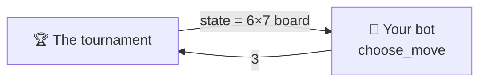

# Player API

To build your own Connect Four player for this repository, you only implement
the `Player` class. It has one method that decides the move: that is your
player's strategy. This page helps you write your own bot from scratch.

---

## Start by copying this

The smallest correct player: always drop the piece in the leftmost column with
room. Copy it, rename it, and you already have a valid bot.

```python
from conecta_cuatro.game import Move, State, legal_moves
from conecta_cuatro.player import Player

class LeftBot(Player):
    @classmethod
    def get_name(cls) -> str:
        return "LeftBot"

    @classmethod
    def get_authors(cls) -> list[str]:
        return ["your name"]

    @classmethod
    def get_description(cls) -> str:
        return "Always drops its piece in the leftmost column with room."

    @classmethod
    def get_icon(cls) -> str:
        return "🪄"

    def choose_move(self, state: State) -> Move:
        return legal_moves(state)[0]
```

That bot plays legal games from start to finish. It loses almost all of them,
but it **competes**. From here on you only change `choose_move`.

---

## What you just implemented



Five methods: four say **who you are** and one **plays**.

| Method | Returns | What it is |
|---|---|---|
| `get_name()` | `str` | your name, **unique** among all admitted players |
| `get_authors()` | `list[str]` | a non-empty list of names |
| `get_description()` | `str` | one or two sentences about your *strategy* |
| `get_icon()` | `str` | **one** emoji, shown beside your name |
| `choose_move(state)` | `int` | the decision: the **column** to drop your piece into |

The first four are `@classmethod`s because the tournament, the web app and the
docs need to label a player **without building one**.

!!! note "Python will not let you forget one"
    All five are abstract, so an incomplete subclass fails when it is
    instantiated, with a message naming what is missing:

    ```text
    TypeError: Can't instantiate abstract class MyBot without an
               implementation for abstract method 'get_name'
    ```

!!! tip "Keep the icon to a single glyph"
    It is rendered where markup is not allowed (the scoreboard, a native
    `<select>`), and a two-glyph sequence breaks table alignment. The built-in
    players use 🎲 `random`, 🌱 `easy`, 🧠 `medium`, ⚔️ `hard`.

---

## The exact types

### What you receive: `state`

A **list of rows**, each a list of cells. `state[0]` is the **top** row and
`state[-1]` the bottom one. Each cell is `0` (empty), `1` (a piece of the first
player, `X`) or `2` (a piece of the second, `O`).

```python
state = [
    [0, 0, 0, 0, 0, 0, 0],   # row 0: top
    [0, 0, 0, 0, 0, 0, 0],
    [0, 0, 0, 0, 0, 0, 0],
    [0, 0, 0, 0, 0, 0, 0],
    [0, 0, 0, 2, 0, 0, 0],
    [0, 0, 1, 1, 0, 0, 0],   # row 5: bottom
]
```

| Fact | Rule |
|---|---|
| Type | `list[list[int]]` |
| `len(state)` | number of rows (6 on the standard board) |
| `len(state[0])` | number of columns (7 on the standard board) |
| Your piece | `game.current_player(state)`: `1` if there are as many `1`s as `2`s, else `2` |
| A finished board | you **never** receive one: the game is already over |

!!! warning "Do not assume 6×7"
    The tournament and the web app allow other sizes. Always read the
    dimensions from `state` itself.

### What you return: the move

An **integer**: the column index, starting at **0**.

```python
return 3              # drop the piece in the centre column
```

A move is **legal** exactly when:

```text
0 <= column < len(state[0])   AND   state[0][column] == 0
```

That is, the column exists and is not full. The single source of truth is
`conecta_cuatro.game.is_legal`. Return a real `int`: not `True`, not `3.0`,
not `"3"`.

---

## Helpers you can use

Your bot may import pure functions from `conecta_cuatro.game`. You do not need
to reimplement any of these:

| Function | What for |
|---|---|
| `legal_moves(state)` | the columns that can still take a piece |
| `is_legal(state, move)` | check a move |
| `apply_move(state, move)` | a **new** state with the mover's piece dropped (no mutation) |
| `current_player(state)` | your piece: `1` or `2` |
| `other(player)` | the rival's piece |
| `winner(state)` | `1`, `2` or `None` |
| `is_terminal(state)` | `True` if someone has won or the board is full |
| `is_draw(state)` | `True` if the board is full with no four in a row |
| `line_through(state, row, column)` | the cells of the four-in-a-row through that piece, if any |

An example that already plays better than `LeftBot`: win if you can, otherwise
play the centre.

```python
from conecta_cuatro import game

def choose_move(self, state):
    for column in game.legal_moves(state):
        if game.winner(game.apply_move(state, column)) is not None:
            return column                       # win now
    centre = len(state[0]) // 2
    return min(game.legal_moves(state), key=lambda c: abs(c - centre))
```

---

## The rules of the environment

The contract is tiny, but the tournament that calls your bot has rules of its
own. They appear in no method signature, so they are easy to forget.

### You have a time budget per game

**2 seconds for the whole game**, not per move. It is cumulative: you may burn
1.5 s on one hard position and play the rest instantly. There is a separate 2 s
budget for building your player. For reference, `hard` (depth-5 minimax) uses
under 0.6 s per game.

!!! warning "Time is measured on GitHub's runners"
    They are slower and more variable than your laptop. A bot that fits the
    budget locally can still time out in the official run. Write efficient
    code.

### Every failure costs that game, never the run

| What you did | Recorded as |
|---|---|
| Went over your game budget, or hung | `forfeit_timeout` |
| Raised while choosing a move | `forfeit_error` |
| Returned something that is not a legal column | `forfeit_illegal` |
| Went over budget while being built | `forfeit_build_timeout` |
| Raised while being built | `forfeit_build_error` |

In every case you lose **that** game, the reason is recorded, and the
tournament goes on. It never goes down because of you — but a bot that fails is
not merged.

### Draws exist

If the board fills up with no four in a row, the game is a **draw**: one point
to each player in the standings (a win is worth three) and half a result in the
Elo rating. Against a strong opponent, a draw is already something.

### Your state lives within one game

Caches, memo tables and the position of your random generator persist from
move to move **within their own game**, and vanish when it ends. Do not try to
carry anything across games.

!!! warning "Keep it small"
    Do not look for move history, timers or the opponent's identity inside
    `choose_move`. Those belong to *the tournament calling you*, not to the
    contract. **A player is a pure function of the board.** And do not modify
    `state`: it is a copy, but a bot that changes it is not merged.

---

## If your bot uses randomness: `create(seed)`

The tournament builds every player by calling `create(seed)`, never the class
directly. By default it does `cls()`, so **you can ignore it**. If your bot uses
randomness or needs configuration, override it:

```python
@classmethod
def create(cls, seed: int) -> "MyBot":
    return cls(depth=4, seed=seed)
```

Using the seed you are given makes your games reproducible: the same
tournament run gives the same result twice.

---

## Optional extras

??? tip "Reuse one of our searches instead of writing your own"
    The searches behind the reference players are public API in
    `conecta_cuatro.bots`. You can subclass one and override only the
    heuristic. `MinimaxBot` calls `evaluate(state, player)` at the depth limit;
    return how good the board is for `player`:

    ```python
    from conecta_cuatro.bots import MinimaxBot

    class MyBot(MinimaxBot):
        # ... get_name, get_authors, get_description, get_icon ...

        @classmethod
        def create(cls, seed: int) -> "MyBot":
            return cls(depth=5, seed=seed)

        def evaluate(self, state, player):
            centre = len(state[0]) // 2
            return sum(1 for row in state if row[centre] == player)
    ```

    `players/builtin/hard.py` is exactly that, with the heuristic of
    `SmartMinimaxBot`. See the source
    [here](https://github.com/grabifv/CONECTA_CUATRO/blob/main/players/builtin/hard.py).

??? tip "Publish your reasoning for the “why did it do that?” panel"
    The minimax-based players fill a `self.last_info` dict after each move with
    the depth searched, the score and the node count. The
    [web page](../advanced/web.md) reads and shows it. You may do the same, but
    it is never required: the tournament ignores it.

---

**Next:** [Submit a player](submit-a-player.md) — the pull request flow, step
by step.
