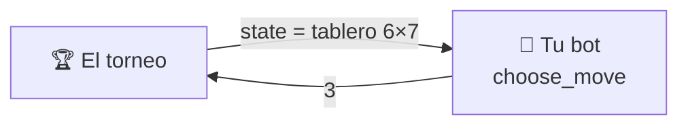

# API de jugador

Para crear tu propio jugador de Conecta Cuatro para este repositorio, solo debes
implementar la clase `Player`. En esta clase tienes un método que decide la
jugada: esa será la estrategia de tu jugador. Esta página te ayuda a escribir
tu propio bot desde cero.

---

## Empieza copiando esto

El jugador correcto más pequeño: soltar siempre la ficha en la columna libre
más a la izquierda. Cópialo, cámbiale el nombre y ya tienes un bot válido.

```python
from conecta_cuatro.game import Move, State, legal_moves
from conecta_cuatro.player import Player

class LeftBot(Player):
    @classmethod
    def get_name(cls) -> str:
        return "LeftBot"

    @classmethod
    def get_authors(cls) -> list[str]:
        return ["tu nombre"]

    @classmethod
    def get_description(cls) -> str:
        return "Always drops its piece in the leftmost column with room."

    @classmethod
    def get_icon(cls) -> str:
        return "🪄"

    def choose_move(self, state: State) -> Move:
        return legal_moves(state)[0]
```

Ese bot juega partidas legales de principio a fin. Pierde casi todas, pero
**compite**. A partir de aquí solo cambias `choose_move`.

---

## Lo que acabas de implementar



Son cinco métodos: cuatro dicen **quién eres** y uno **juega**.

| Método | Devuelve | Qué es |
|---|---|---|
| `get_name()` | `str` | tu nombre, **único** entre todos los jugadores admitidos |
| `get_authors()` | `list[str]` | lista no vacía de nombres |
| `get_description()` | `str` | una o dos frases sobre tu *estrategia* |
| `get_icon()` | `str` | **un** emoji, que se muestra junto a tu nombre |
| `choose_move(state)` | `int` | la decisión: la **columna** donde soltar la ficha |

Los cuatro primeros son `@classmethod` porque el torneo, la web y la
documentación necesitan etiquetar a un jugador **sin construir uno**.

!!! note "Python no te deja olvidarte de ninguno"
    Los cinco son abstractos, así que una subclase incompleta falla al
    instanciarse, con un mensaje que dice cuál falta:

    ```text
    TypeError: Can't instantiate abstract class MyBot without an
               implementation for abstract method 'get_name'
    ```

!!! tip "Que el icono sea un solo glifo"
    Se renderiza en sitios que no admiten marcado (el marcador, un `<select>`
    nativo), y una secuencia de dos glifos rompe la alineación de las tablas.
    Los incluidos usan 🎲 `random`, 🌱 `easy`, 🧠 `medium`, ⚔️ `hard`.

---

## Los tipos exactos

### Lo que recibes: `state`

Una **lista de filas**, cada una una lista de casillas. `state[0]` es la fila
de **arriba** y `state[-1]` la de abajo. Cada casilla vale `0` (vacía), `1`
(ficha del primer jugador, `X`) o `2` (ficha del segundo, `O`).

```python
state = [
    [0, 0, 0, 0, 0, 0, 0],   # fila 0: arriba
    [0, 0, 0, 0, 0, 0, 0],
    [0, 0, 0, 0, 0, 0, 0],
    [0, 0, 0, 0, 0, 0, 0],
    [0, 0, 0, 2, 0, 0, 0],
    [0, 0, 1, 1, 0, 0, 0],   # fila 5: abajo
]
```

| Dato | Regla |
|---|---|
| Tipo | `list[list[int]]` |
| `len(state)` | número de filas (6 en el tablero estándar) |
| `len(state[0])` | número de columnas (7 en el tablero estándar) |
| Tu ficha | `game.current_player(state)`: `1` si hay tantas `1` como `2`, si no `2` |
| Tablero terminado | **nunca** lo recibes: ahí la partida ya ha acabado |

!!! warning "No asumas 6×7"
    El torneo y la web permiten otros tamaños. Lee siempre las dimensiones del
    propio `state`.

### Lo que devuelves: la jugada

Un **entero**: el índice de la columna, empezando en **0**.

```python
return 3              # suelta la ficha en la columna central
```

Una jugada es **legal** exactamente cuando:

```text
0 <= columna < len(state[0])   Y   state[0][columna] == 0
```

Es decir, la columna existe y no está llena. La única fuente de verdad es
`conecta_cuatro.game.is_legal`. Devuelve un `int` real: ni `True`, ni `3.0`,
ni `"3"`.

---

## Utilidades que puedes usar

Tu bot puede importar funciones puras de `conecta_cuatro.game`. No tienes que
reimplementar ninguna de estas:

| Función | Para qué |
|---|---|
| `legal_moves(state)` | las columnas en las que aún cabe una ficha |
| `is_legal(state, move)` | comprobar una jugada |
| `apply_move(state, move)` | un estado **nuevo** con la ficha del jugador al que le toca (sin mutar) |
| `current_player(state)` | tu ficha: `1` o `2` |
| `other(player)` | la ficha del rival |
| `winner(state)` | `1`, `2` o `None` |
| `is_terminal(state)` | `True` si alguien ha ganado o el tablero está lleno |
| `is_draw(state)` | `True` si el tablero está lleno sin cuatro en línea |
| `line_through(state, fila, columna)` | las casillas del cuatro en línea que pasa por esa ficha, si lo hay |

Un ejemplo que ya juega mejor que `LeftBot`: gana si puede y, si no, juega al
centro.

```python
from conecta_cuatro import game

def choose_move(self, state):
    for column in game.legal_moves(state):
        if game.winner(game.apply_move(state, column)) is not None:
            return column                       # gano ya
    centre = len(state[0]) // 2
    return min(game.legal_moves(state), key=lambda c: abs(c - centre))
```

---

## Las reglas del entorno

El contrato es diminuto, pero el torneo que llama a tu bot tiene sus propias
reglas. No aparecen en ninguna firma de método, así que es fácil olvidarlas.

### Tienes un presupuesto de tiempo por partida

**2 segundos para toda la partida**, no por jugada. Es acumulativo: puedes
quemar 1,5 s en una posición difícil y jugar el resto al instante. Hay un
segundo presupuesto aparte de 2 s para construir tu jugador. Como referencia,
`hard` (minimax a profundidad 5) usa menos de 0,6 s por partida.

!!! warning "El tiempo se mide en los runners de GitHub"
    Son más lentos y más variables que tu portátil. Un bot que cabe en el
    presupuesto en local todavía puede agotar el tiempo en la ejecución
    oficial. Escribe código eficiente.

### Cada fallo cuesta esa partida, nunca la ejecución

| Qué hiciste | Se registra como |
|---|---|
| Superaste tu presupuesto de partida, o te colgaste | `forfeit_timeout` |
| Lanzaste una excepción al elegir jugada | `forfeit_error` |
| Devolviste algo que no es una columna legal | `forfeit_illegal` |
| Superaste el presupuesto al construirte | `forfeit_build_timeout` |
| Lanzaste una excepción al construirte | `forfeit_build_error` |

En todos los casos pierdes **esa** partida, se registra el motivo y el torneo
continúa. Nunca se cae por tu culpa — pero un bot que falla no se fusiona.

### Los empates existen

Si el tablero se llena sin cuatro en línea, la partida es un **empate**: un
punto para cada jugador en la clasificación (una victoria vale tres) y medio
resultado en el Elo. Contra un rival fuerte, empatar ya es algo.

### Tu estado vive dentro de una partida

Las cachés, tablas de memoización y la posición de tu generador aleatorio
persisten de jugada a jugada **dentro de su propia partida**, y desaparecen al
terminarla. No intentes arrastrar nada entre partidas.

!!! warning "Mantenlo pequeño"
    No busques historial de jugadas, temporizadores ni la identidad del rival
    dentro de `choose_move`. Eso pertenece al *torneo que te llama*, no al
    contrato. **Un jugador es una función pura del tablero.** Y no modifiques
    `state`: es una copia, pero un bot que la cambia no se fusiona.

---

## Si tu bot usa azar: `create(seed)`

El torneo construye todos los jugadores llamando a `create(seed)`, nunca a la
clase directamente. Por defecto hace `cls()`, así que **puedes ignorarlo**. Si
tu bot usa azar o necesita configuración, sobreescríbelo:

```python
@classmethod
def create(cls, seed: int) -> "MyBot":
    return cls(depth=4, seed=seed)
```

Usar la semilla que te dan hace que tus partidas sean reproducibles: la misma
ejecución del torneo da el mismo resultado dos veces.

---

## Extras opcionales

??? tip "Reutilizar una de nuestras búsquedas en vez de escribir la tuya"
    Las búsquedas que hay detrás de los jugadores de referencia son API pública
    en `conecta_cuatro.bots`. Puedes heredar de una y sobreescribir solo la
    heurística. `MinimaxBot` llama a `evaluate(state, player)` al llegar al
    límite de profundidad; devuelve lo bueno que es el tablero para `player`:

    ```python
    from conecta_cuatro.bots import MinimaxBot

    class MiBot(MinimaxBot):
        # ... get_name, get_authors, get_description, get_icon ...

        @classmethod
        def create(cls, seed: int) -> "MiBot":
            return cls(depth=5, seed=seed)

        def evaluate(self, state, player):
            centre = len(state[0]) // 2
            return sum(1 for row in state if row[centre] == player)
    ```

    `players/builtin/hard.py` es exactamente eso con la heurística de
    `SmartMinimaxBot`. Puedes ver el código fuente
    [aquí](https://github.com/grabifv/CONECTA_CUATRO/blob/main/players/builtin/hard.py).

??? tip "Publicar tu razonamiento para el panel «¿por qué ha hecho eso?»"
    Los jugadores basados en minimax rellenan un diccionario `self.last_info`
    tras cada jugada con la profundidad explorada, la puntuación y el número de
    nodos. La [página web](../advanced/web.md) lo lee y lo muestra. Puedes hacer
    lo mismo, pero nunca es obligatorio: el torneo lo ignora.

---

**Siguiente:** [Enviar un jugador](submit-a-player.md) — el flujo de pull
request, paso a paso.
